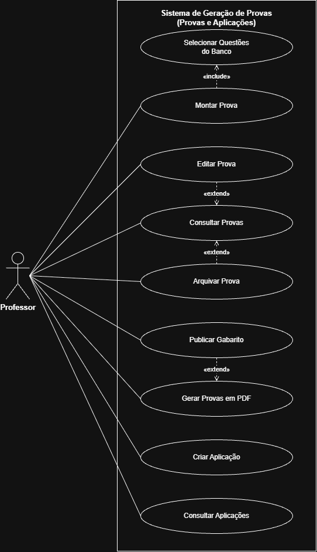
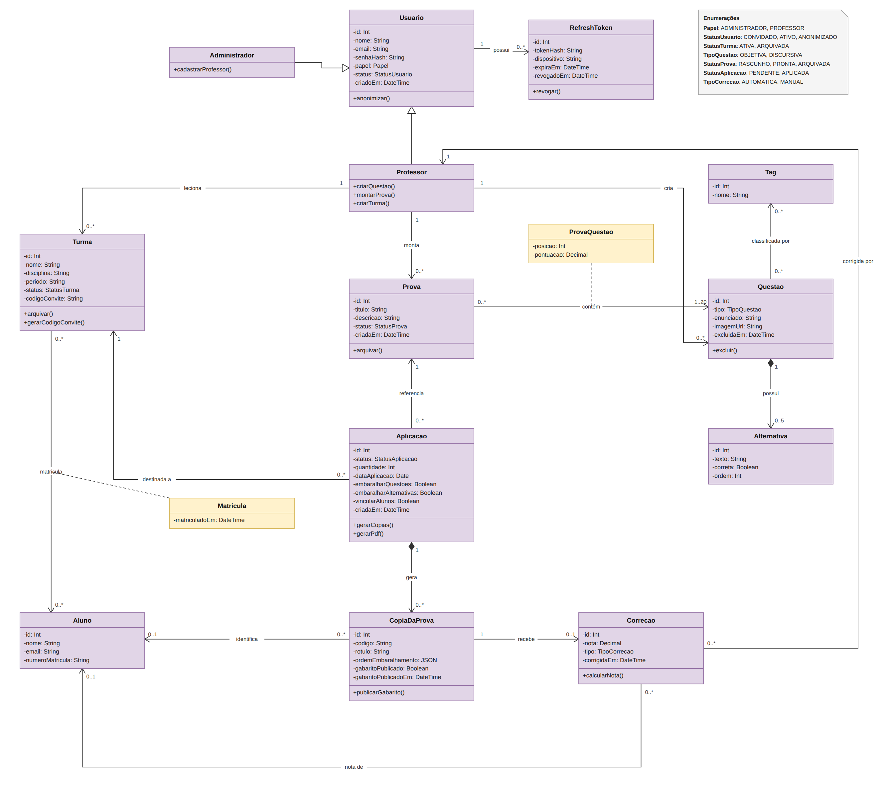
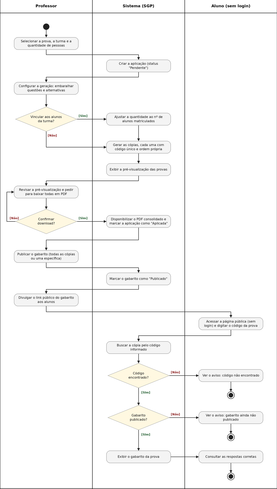
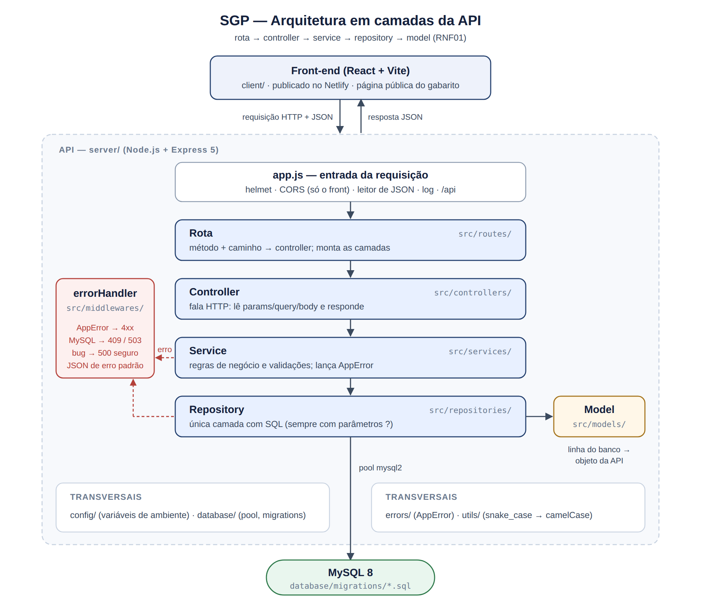
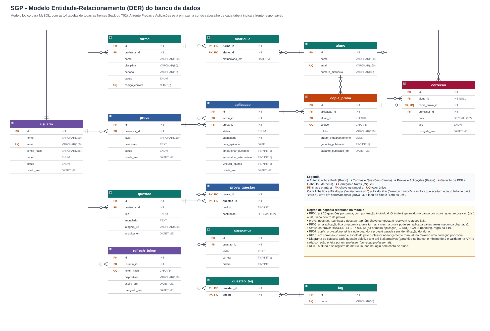

<div align="center">

# 🚀 SGP – Sistema de Geração de Provas

**Plataforma web para professores criarem, aplicarem e corrigirem provas de forma automatizada. O aluno não acessa a plataforma: consulta o gabarito publicado por um link público, sem necessidade de login.**

🔗 **Link do sistema hospedado:** ([https://projeto5fase.netlify.app/](https://projeto5fase.netlify.app/))
<br>
🔗 **Link dos slides:** https://catolicasc-my.sharepoint.com/:p:/g/personal/matheus_kuchenbecker_catolicasc_edu_br/IQAvxzL0gGprSa9NjLN3J_VeATAhEe-oNpuc5HMO3loNs6I?e=BOYppk


</div>

## 👥 Equipe

| Nome completo | Papel / principais frentes no projeto |
|---|---|
| BRUNO ROVANI MARCELINO | Autenticação e Perfil — cadastro de professor por um administrador, login de professor/administrador, JWT/refresh token, anonimização de conta (LGPD) |
| CAMILA TEXEIRA | 	Turmas e Questões — criação de turmas, matrícula por e-mail/código de convite, CRUD do banco de questões |
| FELIPE DOS SANTOS | Provas e Aplicações — montagem de provas (banco de questões da prova), aplicação de provas a turmas |
| MATHEUS KUCHENBECKER | Geração de PDF e Gabarito — versões, embaralhamento de questões/alternativas, identificação do aluno, publicação de gabarito |
| MIGUEL CARLOS BERTOLDI | Correção e Notas — fluxo de correção, lançamento manual de nota, relatórios e histórico de notas por turma |

## 📑 Sumário

- [1. Visão Geral](#1-visão-geral)
- [2. Requisitos](#2-requisitos)
  - [2.1 Funcionais (RF)](#21-funcionais-rf)
  - [2.2 Não Funcionais (RNF)](#22-não-funcionais-rnf)
- [3. Modelagem (UML)](#3-modelagem-uml)
- [4. Telas do Sistema](#4-telas-do-sistema)
- [5. Arquitetura de Software](#5-arquitetura-de-software)
- [6. Decisões Arquiteturais (ADRs)](#6-decisões-arquiteturais-adrs)
- [7. Modelo de Dados](#7-modelo-de-dados)
  - [7.1 Estado da integração com o banco](#71-estado-da-integração-com-o-banco)
- [8. Stack Tecnológica](#8-stack-tecnológica)
- [9. Estrutura de Pastas](#9-estrutura-de-pastas)
- [10. Como Executar o Projeto](#10-como-executar-o-projeto)
  - [10.1 Pré-requisitos](#101-pré-requisitos)
  - [10.2 Configurar o back-end e o banco](#102-configurar-o-back-end-e-o-banco)
  - [10.3 Criar o primeiro administrador](#103-criar-o-primeiro-administrador)
  - [10.4 Iniciar o front-end](#104-iniciar-o-front-end)
  - [10.5 Problemas comuns](#105-problemas-comuns)
- [11. Especificação da API](#11-especificação-da-api)
- [12. Testes e Validações](#12-testes-e-validações)
- [13. Manual do Usuário](#13-manual-do-usuário)
- [14. Equipe e Contribuições](#14-equipe-e-contribuições)

---

## 1. Visão Geral

📌 **N1**

**Contexto e problema**

O projeto nasce de uma dor real relatada por professores da Católica SC: em semanas de avaliação, um único professor pode acumular de 200 a 400 provas para corrigir manualmente, um tempo desproporcional diante das demais atividades da rotina docente (aulas, orientações, gestão de turma). Hoje esse processo é resolvido por ferramentas de terceiros como o **GradePen** (gera a prova com embaralhamento de questões/alternativas e corrige via QR Code, mas não indica qual alternativa o aluno marcou em cada questão) e o **Prova Fácil** (faz essa análise estatística, mas não permite montar a prova dentro do próprio sistema, e a geração de caderno de provas nominal só existe no plano pago institucional). Nenhuma das duas resolve o problema de ponta a ponta.

**Objetivo**

Entregar uma plataforma que permita ao professor cadastrar questões, montar provas, gerar o PDF de aplicação (com controle de versões, embaralhamento de questões e alternativas e, quando desejado, identificação do aluno), corrigir a prova a partir da leitura do gabarito preenchido e lançar as notas — tudo em um único sistema para professores da Católica SC, reduzindo o tempo de correção e concentrando em um só lugar o que hoje está dividido entre ferramentas concorrentes. **O aluno não tem conta nem login no sistema**: o único ponto de contato dele é o gabarito publicado, acessado por um link público.

**Escopo**

Dentro do escopo do projeto:

- Cadastro de professores feito por um administrador; login de professores e administradores (alunos não fazem login).
- Cada professor só acessa suas próprias turmas, questões e provas — isolamento de dados é entre contas de professor, não entre alunos.
- Banco de questões por professor, objetivas e discursivas.
- Criação de turmas e matrícula de alunos como registro (nome/e-mail informados pelo professor), sem gerar conta de acesso para o aluno.
- Criação de provas reutilizáveis (banco de questões da prova) e aplicação dessas provas a uma ou mais turmas.
- Geração de um PDF único consolidado por aplicação, com quantidade configurável de versões, embaralhamento de questões e alternativas, e opção de prova com ou sem identificação do aluno.
- Publicação de gabarito (por versão ou por aplicação) em um link público, sem exigir login do aluno.
- Correção automatizada a partir da leitura do gabarito preenchido pelo aluno.
- Lançamento manual de nota quando a prova foi gerada sem identificação do aluno.
- Relatórios de notas (por aplicação e consolidados), com exportação.
- Histórico de notas e desempenho do aluno, consultado pelo professor (o aluno não tem essa consulta dentro do sistema).

Fora do escopo do semestre (ponto em aberto, a validar com o cliente e com a professora da disciplina antes da apresentação de 28/08):

- **App mobile nativo** dedicado à leitura de QR Code — a especificação de referência do cliente prevê um app React Native exclusivo do professor para essa etapa; como a disciplina exige stack **Node.js + Express + MySQL**, a equipe ainda vai decidir se a correção será feita via **web** (ex.: upload da foto do gabarito) ou se o app mobile fica como extensão futura, fora do MVP entregue no semestre.
- **Arquitetura de microsserviços** (Auth, Exam/Class/Application, Grade, Sync, Vision) proposta na especificação de referência — o projeto da disciplina segue uma **arquitetura em camadas única** (rota → controle → serviço → repositório → model), conforme exigido pela metodologia da disciplina.
- Fila de sincronização offline e deduplicação de correções (dependem diretamente do app mobile acima).
- Exclusão física de dados (LGPD) — só a anonimização de conta está prevista.
- **Conta e login de aluno na plataforma** — decisão validada com o cliente: o aluno nunca acessa o sistema diretamente. Contas de professor são criadas por um administrador; o único ponto de contato do aluno é o gabarito publicado via link público, sem autenticação.

## 2. Requisitos

📌 **N1** (podem ser ajustados nas entregas seguintes, se o escopo mudar)

### 2.1 Funcionais (RF)

| Código | Requisito |
|---|---|
| RF01 | O sistema deve permitir cadastro de professores por um administrador, e login de professores e administradores. O aluno não possui login. |
| RF02 | O professor deve poder criar, editar, listar e excluir (soft-delete) questões objetivas e discursivas, com tags e filtros — sempre restrito ao próprio banco de questões do professor. |
| RF03 | O professor deve poder criar turmas e matricular alunos informando nome e e-mail; a matrícula é apenas um registro para identificação nas provas, não cria conta de acesso para o aluno. |
| RF04 | O professor deve poder montar provas com quantidade livre de questões (até 20) e pontuação definida individualmente por questão. |
| RF05 | O professor deve poder aplicar uma prova já criada a uma ou mais turmas, gerando aplicações independentes entre si (permitindo reaplicação, ex.: segunda chamada). |
| RF06 | O sistema deve gerar um PDF único e consolidado por aplicação, com opção de múltiplas versões e embaralhamento independente de questões e de alternativas por versão. |
| RF07 | O sistema deve permitir gerar a prova com ou sem identificação do aluno no cabeçalho. |
| RF08 | O sistema deve permitir a publicação do gabarito (por versão ou por aplicação) em um link público, acessível pelo aluno sem necessidade de login. |
| RF09 | O sistema deve corrigir automaticamente a prova a partir da leitura do gabarito preenchido, calculando a nota conforme a pontuação de cada questão. |
| RF10 | Quando a prova foi gerada sem identificação, o professor deve poder lançar manualmente a nota, associando-a ao aluno correto. |
| RF11 | O professor deve poder gerar relatórios de notas por aplicação e consolidados, com exportação (ao menos CSV/Excel). |
| RF12 | O professor deve poder consultar o histórico de notas e desempenho de cada aluno dentro de suas turmas. |

### 2.2 Não Funcionais (RNF)

| Código | Requisito |
|---|---|
| RNF01 | O sistema deve seguir a arquitetura em camadas definida pela disciplina: rota → controle → serviço → repositório → model. |
| RNF02 | As senhas devem ser armazenadas com hash seguro (ex.: bcrypt), nunca em texto puro. |
| RNF03 | O login deve emitir token JWT de acesso e refresh token, com suporte a logout do dispositivo atual e logout de todos os dispositivos. |
| RNF04 | O isolamento de dados entre professores deve ser garantido: um professor só pode acessar suas próprias turmas, questões, provas e notas. Alunos não autenticam no sistema, então esse isolamento não se aplica a eles. |
| RNF05 | O sistema deve responder em tempo aceitável em uma conexão padrão (meta inicial: até 2s nas operações comuns). |
| RNF06 | O sistema deve estar hospedado em um serviço gratuito (Netlify, Vercel, GitHub Pages ou similar) e permanecer acessível ao longo do semestre. |

## 3. Modelagem (UML)

📌 **N2**

Diagramas do sistema: casos de uso, classes, atividades e sequência. Os arquivos ficam em `docs/uml/`, e as classes de domínio estão documentadas em [`docs/uml/README.md`](docs/uml/README.md).

## Diagrama de Casos de Uso



O diagrama acima representa a parte de Provas e Aplicações do SGP (RF04 e RF05). O único ator é o Professor, já que o sistema não oferece acesso a alunos. Os casos de uso cobrem a montagem de provas (montar, editar, arquivar e consultar), que sempre inclui a seleção de questões do banco, e o ciclo das aplicações (criar a aplicação para uma turma, gerar as provas em PDF, publicar o gabarito e consultar as aplicações). A relação «include» indica o passo obrigatório de selecionar questões ao montar uma prova. As relações «extend» indicam passos opcionais: editar ou arquivar partem da consulta de provas, e publicar o gabarito só é possível depois que as provas em PDF foram geradas.

## Diagrama de Classes



## Diagrama de Atividades



Escolha do fluxo

O caso de uso do grupo (`casos-de-uso.png`) tem várias ações do Professor: *Criar Aplicação*, *Gerar Provas em PDF* e *Publicar Gabarito*. Elas formam **um único fluxo de ponta a ponta**, e é o único em que o processo passa por mais de um participante (Professor, Sistema e, no final, o Aluno). Por isso foi o escolhido, e por isso o diagrama usa **raias**.

Início e fim

| | Descrição |
|---|---|
| **Início** | O Professor decide aplicar uma prova e seleciona prova, turma e quantidade de pessoas. |
| **Fim 1** | Aluno informa um código que não existe → vê o aviso "código não encontrado". |
| **Fim 2** | Código existe, mas o professor ainda não publicou → aviso "gabarito ainda não publicado". |
| **Fim 3** | Código existe e o gabarito está publicado → aluno consulta as respostas corretas. |

| Raia | Responsabilidades |
|---|---|
| **Professor** | Configurar e pedir a geração, revisar, confirmar o download, publicar e divulgar o gabarito |
| **Sistema (SGP)** | Criar aplicação, gerar cópias, exibir pré-visualização, disponibilizar PDF, marcar como publicado, buscar cópia por código |
| **Aluno (sem login)** | Acessar a página pública, informar o código e consultar o resultado |

> O Aluno **não tem conta nem login** (decisão de escopo do projeto): o único contato dele com o sistema é a consulta pública do gabarito por código.

## Diagramas de Sequência

Mostram a troca de mensagens entre o usuário, o front-end, a API e o MySQL nos três fluxos principais. Foram desenhados no planejamento, então os nomes de algumas rotas diferem da API implementada; as rotas reais estão na [seção 11](#11-especificação-da-api).

**1. Cadastro de professor pelo administrador e login**


**2. Banco de questões, montagem da prova, aplicação e geração do PDF**


**3. Publicação do gabarito, consulta pelo aluno, correção e relatório**


## 4. Telas do Sistema

### 📌 N1 — Telas do Sistema

Prints das telas principais, apresentados na ordem do fluxo de navegação (a tela A leva à tela B).

Cada imagem é acompanhada de uma breve descrição de sua funcionalidade.

### 4.1 Tela de Login

<p align="center">
  
</p>

**Descrição:** Vista apresentada ao entrar no sistema, contendo os campos de **e-mail** e **senha**.

---

### 4.2 Entrada no Sistema

<p align="center">
  
</p>

**Descrição:** Ao entrar no sistema, é apresentada diretamente a tela de **Questões**, onde é possível criar, editar ou excluir questões existentes.

---

### 4.3 Tópicos do Sistema

<p align="center">
  
</p>

**Descrição:** No lado direito, ficam os tópicos/temas do sistema, separados em:

- **CONTEÚDO:** Questões e Provas
- **OPERAÇÃO:** Aplicações e Turmas
- **SISTEMA:** Administração

---

### 4.4 Provas

<p align="center">
  
</p>

**Descrição:** Na aba de **Provas**, é possível criar uma nova prova e visualizar provas em **rascunho**, **prontas** e/ou **arquivadas**.

<p align="center">
  
</p>

**Descrição:** Ao clicar em **Criar prova**, é exibido todo o banco de questões existentes, além da possibilidade de definir o nome da prova.

---

### 4.5 Aplicações

<p align="center">
  
</p>

**Descrição:** Com a prova criada, é possível realizar uma aplicação. Ao clicar em **+ Criar aplicação**, o usuário é redirecionado para outra tela, onde seleciona a prova e a turma em que ela será aplicada.

<p align="center">
  
</p>

---

### 4.6 Turmas

<p align="center">
  
</p>

**Descrição:** Na aba de **Turmas**, é possível criar ou editar uma turma existente. Ao clicar em **+ Criar Turma**, devem ser preenchidos os seguintes dados:

- **Nome:** 
- **Disciplina:** 
- **Período / ano letivo:** 

<p align="center">
  
</p>

**Descrição:** Ao acessar uma turma já criada, é possível visualizar todas as provas aplicadas a ela.

<p align="center">
  
</p>

**Descrição:** Visualização das aplicações vinculadas à turma.

<p align="center">
  
</p>

**Descrição:** Visualização detalhada de uma aplicação selecionada.

---

### 4.7 Administração

<p align="center">
  
</p>

**Descrição:** Local destinado à criação e gerenciamento de usuários, como **professores** e **administradores**. Essa tela **somente é exibida para usuários com perfil de Administrador**.

É possível criar um novo usuário informando:

- **Nome**
- **E-mail**
- **Papel:** Professor ou Administrador

<p align="center">
  
</p>

**Descrição:** Após a criação, é possível editar os dados do usuário.

<p align="center">
  
</p>

**Descrição:** Após a criação do usuário, é exibido também o campo **Status**, que pode assumir os valores **Convidado** (aguardando liberação) ou **Ativo** (usuário ativo no sistema).

<p align="center">
  
</p>

**Descrição:** Ao clicar em **Remover**, é exibido um pop-up solicitando a confirmação da ação.

<p align="center">
  
</p>


## 5. Arquitetura de Software

📌 **N3** (pode ser esboçada antes, mas passa a ser obrigatória na entrega final)

A API (`server/`) segue a arquitetura em camadas da disciplina: `rota → controle → serviço → repositório → model`. Cada requisição do front-end atravessa as camadas sempre na mesma ordem e volta pelo mesmo caminho como JSON, e cada camada só conhece a de baixo:

| Camada | Responsabilidade | Não pode |
|---|---|---|
| **Rota** (`routes/`) | Liga método + caminho ao controller e monta as camadas do recurso | Ter regra de negócio ou SQL |
| **Controle** (`controllers/`) | Fala HTTP: lê parâmetros e corpo, chama o serviço e devolve a resposta | Decidir regra de negócio ou acessar o banco |
| **Serviço** (`services/`) | Regras de negócio e validações; lança `AppError` quando algo é inválido | Conhecer `req`/`res` ou escrever SQL |
| **Repositório** (`repositories/`) | Única camada com SQL, sempre com parâmetros (`?`) | Ter regra de negócio |
| **Model** (`models/`) | Converte a linha do banco no objeto usado pela API | Acessar banco ou HTTP |

Erros não são respondidos pelas camadas: elas lançam, e o middleware `errorHandler` transforma tudo no mesmo formato JSON (`{ "error": { "code", "message" } }`), sem vazar detalhes internos. As camadas recebem a de baixo por parâmetro (injeção de dependências), o que permite testar regras e rotas sem MySQL.



Documento completo, com o caminho de uma requisição passo a passo, tratamento de erros, segurança e como criar um recurso novo: [`docs/arquitetura/arquitetura-em-camadas.md`](docs/arquitetura/arquitetura-em-camadas.md).

## 6. Decisões Arquiteturais (ADRs)

📌 **N2** (primeiras decisões, como a escolha do banco e da estrutura de camadas) e **N3** (registro completo)

Um ADR (*Architecture Decision Record*) documenta uma decisão técnica importante: o que foi decidido, por quê, e quais as consequências. Crie um arquivo por decisão em `docs/adr/`, numerado (`ADR-001-nome-da-decisao.md`, `ADR-002-...`), seguindo este modelo mínimo dentro de cada arquivo:

```
# ADR-001: Título curto da decisão

## Contexto
Qual problema ou dúvida técnica motivou essa decisão.

## Decisão
O que a equipe decidiu fazer.

## Consequências
O que essa escolha facilita, o que ela custa ou limita.
```

ADRs (Registros de Decisão Arquitetural) do projeto:

- [ADR-001: Escopo reduzido em relação à especificação de referência do cliente](docs/adr/ADR-001-escopo-reduzido-sem-app-mobile-e-microsservicos.md)
- [ADR-002: API em camadas (rota → controller → service → repository → model)](docs/adr/ADR-002-arquitetura-em-camadas.md)
- [ADR-003: MySQL como banco e estrutura criada por migrations versionadas](docs/adr/ADR-003-mysql-com-migrations-versionadas.md)
- [ADR-004: Autenticação com JWT, refresh token rotativo e cadastro por convite](docs/adr/ADR-004-autenticacao-jwt-com-refresh-token-e-cadastro-por-convite.md)
- [ADR-005: Ciclo de status da prova (Rascunho → Pronta → Arquivada)](docs/adr/ADR-005-ciclo-de-status-da-prova.md)


## 7. Modelo de Dados

📌 **N2**



- **Dicionário de dados** (campos, tipos e descrição de cada tabela): [`docs/modelo-dados/dicionario-dados.md`](docs/modelo-dados/dicionario-dados.md)
- **Script SQL de criação:** [`docs/modelo-dados/schema.sql`](docs/modelo-dados/schema.sql)
- **Fonte editável do diagrama:** [`docs/modelo-dados/mer-der.drawio`](docs/modelo-dados/mer-der.drawio)

O banco é criado pelas migrations de `server/database/migrations/`, aplicadas em ordem com `npm run db:migrate`:

| Migration | O que cria |
|---|---|
| `001_criar_tabelas.sql` | As 14 tabelas do domínio: `usuario`, `refresh_token`, `turma`, `aluno`, `matricula`, `questao`, `tag`, `questao_tag`, `alternativa`, `prova`, `prova_questao`, `aplicacao`, `copia_prova` e `correcao` |
| `002_configuracoes.sql` | `configuracoes`: nome da instituição e período padrão |
| `003_correcao_respostas.sql` | `correcao_resposta`: resposta de cada questão em uma correção |

### 7.1 Estado da integração com o banco

Posição em 30/10/2026, entrega da N2.

| Frente | Parte | Lê e grava no MySQL? | Observação |
|---|---|---|---|
| Autenticação | Login, JWT e refresh token (T07) | ✅ Sim | |
| Administração | Usuários e configurações (T10) | ✅ Sim | |
| Turmas | Criar, editar e arquivar (T13) | ✅ Sim | |
| Turmas | Matrícula de alunos (T15) | ✅ Sim | |
| Turmas | Código de convite (T14) | 🟡 Em PR (#38) | Ainda não integrado à main |
| Questões | Listar, criar, editar e excluir (T11) | ✅ Sim | Só objetivas pela tela. A lista ainda mistura as questões de exemplo de `client/src/data/questions.json` (T35) |
| Questões | Upload de imagem (T12) | ✅ Sim | Arquivos em `server/uploads/questoes`; o banco guarda o caminho |
| Provas | Criar, listar, editar e arquivar (T17) | ✅ Sim | |
| Aplicações | Criar, configurar e marcar como aplicada, com a regra de status da prova (T18 e T19) | ✅ Sim | |
| PDF e Gabarito | Cópias e publicação do gabarito (T23) | ✅ Sim | Geradas pelo servidor em `copia_prova` |
| PDF e Gabarito | Cópias vinculadas aos alunos matriculados (T24) | ✅ Sim | Uma cópia nominal por aluno |
| PDF e Gabarito | Geração e download do PDF no servidor (T25) | ✅ Sim | Questão discursiva ainda não é aceita no PDF; imagens WEBP e GIF ficam de fora, com aviso |
| PDF e Gabarito | Consulta pública do gabarito, sem login (T26) | ✅ Sim | |
| PDF e Gabarito | Exportação do gabarito em PDF (T27) | ✅ Sim | |
| Correção e Notas | Correção, lançamento manual, relatórios e histórico (T29 a T33) | ✅ Sim | O professor lê o QR e marca as respostas na tela; a leitura automática das marcações da folha ainda não existe |

Os arquivos JSON de `client/src/data/` são dados de exemplo da N1. Só o `questions.json` ainda é importado pelo sistema; a varredura final dos dados fixos é a tarefa T35.

## 8. Stack Tecnológica

📌 **N1** (lista inicial, pode crescer nas entregas seguintes)

Tecnologias usadas no projeto e por que cada uma foi escolhida. A stack obrigatória da disciplina é:


**Back-end (`server/`)**

- **Node.js 20.19+**: ambiente de execução (testado com Node 22).
- **Express 5**: rotas e API REST.
- **MySQL 8** com **mysql2**: banco de dados relacional e driver de conexão (pool).
- **cors**: libera apenas o endereço do front-end para chamar a API.
- **helmet**: cabeçalhos HTTP de segurança.
- **dotenv**: leitura das variáveis de ambiente do arquivo `.env`.
- **bcryptjs**: hash das senhas.
- **pdf-lib** e **qrcode**: montagem do PDF das provas e do gabarito, com o QR Code de cada cópia.
- **multer**: recebimento das imagens enviadas nas questões.

**Front-end (`client/`)**

- **React 19** com **Vite 8**: interface e servidor de desenvolvimento.
- **React Router 7**: navegação entre as telas.
- **qrcode** e **jsQR**: exibição e leitura do QR Code das provas.


## 9. Estrutura de Pastas

📌 **N1**, atualizada conforme o projeto cresce

```
Projeto-e-Arquitetura-5-fase/
├── client/                       # Aplicação web React com Vite
│   ├── public/                   # Arquivos estáticos usados pelo frontend
│   ├── src/
│   │   ├── components/           # Componentes reutilizáveis e modais
│   │   ├── context/              # Estado e dados compartilhados da aplicação
│   │   ├── data/                 # Dados de exemplo da N1 (ver seção 7.1)
│   │   ├── layouts/              # Estruturas visuais compartilhadas
│   │   ├── pages/                # Telas do sistema
│   │   ├── services/             # Chamadas à API e sessão do usuário
│   │   ├── utils/                # Funções auxiliares
│   │   ├── App.jsx               # Rotas e composição das telas
│   │   ├── index.css             # Estilos globais
│   │   └── main.jsx              # Ponto de entrada do React
│   ├── index.html
│   ├── package.json              # Dependências e comandos do frontend
│   ├── package-lock.json
│   └── vite.config.js
├── server/                       # API Node.js + Express + MySQL (arquitetura em camadas)
│   ├── database/migrations/      # Scripts .sql do banco, aplicados em ordem
│   ├── database/seeds/           # Dados de demonstração (npm run db:seed)
│   ├── src/
│   │   ├── routes/               # Endpoints, ligados aos controllers
│   │   ├── controllers/          # Recebem a requisição e devolvem a resposta
│   │   ├── services/             # Regras de negócio
│   │   ├── repositories/         # Acesso ao banco (único lugar com SQL)
│   │   ├── models/               # Representação das entidades
│   │   ├── middlewares/          # Tratamento de erros, 404 e log de requisições
│   │   ├── errors/               # Erros esperados da aplicação (AppError)
│   │   ├── pdf/                  # Montagem do PDF das provas e do gabarito
│   │   ├── database/             # Pool de conexão e migrations
│   │   ├── config/               # Leitura das variáveis de ambiente
│   │   ├── utils/                # Funções auxiliares
│   │   ├── app.js                # Montagem do Express
│   │   └── server.js             # Ponto de entrada da API
│   ├── test/                     # Testes automatizados
│   ├── .env.example              # Modelo das variáveis de ambiente
│   ├── docker-compose.yml        # MySQL 8 para desenvolvimento
│   └── package.json
├── docs/
│   ├── adr/                      # Registros de decisões de arquitetura
│   ├── api/                      # Especificação detalhada da API por frente
│   ├── arquitetura/              # Documento e diagrama da arquitetura em camadas
│   ├── modelo-dados/             # MER/DER, script SQL e dicionário de dados
│   └── uml/                      # Diagramas UML do projeto
└── README.md
```

## 10. Como Executar o Projeto

📌 **N1**, revisado a cada entrega.

Estas instruções são para executar o projeto localmente no Windows, Linux ou macOS. Para desenvolvimento, mantenha o back-end e o front-end em terminais separados. O banco pode ser executado pelo Docker ou por uma instalação local do MySQL — escolha apenas uma das opções.

### 10.1 Pré-requisitos

- **Git**, para clonar o repositório.
- **Node.js 20.19 ou superior** e npm.
- **MySQL 8.0**, instalado localmente, ou **Docker Desktop** em execução para usar o banco em contêiner.

Confira as versões com `node -v` e `npm -v`. Se for usar Docker, confira também `docker --version` e `docker compose version`.

### 10.2 Configurar o back-end e o banco

Clone o projeto e instale as dependências do servidor:

```bash
git clone https://github.com/Felipe-S-prog/Projeto-e-Arquitetura-5-fase.git
cd Projeto-e-Arquitetura-5-fase/server
npm install
```

Crie o arquivo local de configuração a partir do exemplo.

**Windows PowerShell:**

```powershell
Copy-Item .env.example .env
```

**Linux/macOS (ou Git Bash):**

```bash
cp .env.example .env
```

O arquivo deve ficar em `server/.env`, não na raiz do repositório. Abra-o e confira as variáveis do banco e da autenticação. A configuração inicial do exemplo é:

```env
PORT=3333
CLIENT_ORIGIN=http://localhost:5173
DB_HOST=127.0.0.1
DB_PORT=3306
DB_USER=sgp
DB_PASSWORD=sgp_dev
DB_NAME=sgp
ALLOW_ADMIN_BOOTSTRAP=true
ADMIN_EMAIL_DOMAINS=catolicasc.org.br
PROFESSOR_EMAIL_DOMAINS=catolicasc.org.br,catolicasc.edu.br
```

Os valores `sgp`/`sgp_dev` são destinados ao desenvolvimento com o Docker Compose do projeto. Se usar um MySQL já instalado na máquina, substitua `DB_USER` e `DB_PASSWORD` pelas credenciais desse servidor e mantenha `DB_PORT` igual à porta em que ele está escutando. Não é necessário criar as tabelas manualmente pelo MySQL Workbench: as migrations fazem isso.

**Opção A — MySQL pelo Docker (recomendado para um ambiente novo)**

Na pasta `server`, execute:

```bash
docker compose up -d
```

O Docker cria o contêiner `sgp-mysql` e, na primeira inicialização do volume, configura o banco e o usuário definidos no `.env`.

Se o comando informar que a porta `3306` já está ocupada, há outro MySQL ou serviço usando essa porta. Para manter os dois serviços, mude `DB_PORT=3307` no `server/.env` e execute novamente `docker compose up -d`. A porta publicada no computador será `3307`, mas o MySQL dentro do contêiner continuará na `3306`. Como o servidor também lê `DB_PORT` do mesmo `.env`, a API se conectará pela porta correta.

Se o contêiner já foi inicializado anteriormente, mudar `DB_USER` ou `DB_PASSWORD` no `.env` não altera automaticamente as credenciais gravadas no volume existente. Nesse caso, confira as credenciais do volume ou use um MySQL novo. **Não remova o volume com `docker compose down -v` sem ter certeza de que pode apagar os dados locais.**

**Opção B — MySQL já instalado no computador**

Não execute `docker compose up -d`. No `server/.env`, configure o usuário, a senha, a porta e o nome do banco de acordo com essa instalação. O usuário precisa ter permissão para criar o banco `sgp` e as tabelas. Se o servidor local usa a porta padrão, normalmente `DB_PORT=3306`.

**Aplicar as migrations e iniciar a API**

Ainda na pasta `server`, execute:

```bash
npm run db:migrate
npm test
npm run dev
```

`npm run db:migrate` cria o banco quando necessário e aplica as migrations pendentes. Não edite migrations que já foram aplicadas e não execute `npm run db:reset` sem entender que ele apaga e recria as estruturas e os dados locais.

Para conferir a API e o banco, abra:

- <http://localhost:3333/api/health> — deve retornar um JSON com `"status":"ok"`. Isso é esperado: este endereço é apenas a verificação da API, não a interface do sistema.
- <http://localhost:3333/api/health/db> — verifica se o back-end consegue consultar o MySQL.

Deixe o terminal da API aberto enquanto estiver usando o sistema.

### 10.3 Criar o primeiro administrador

Com o back-end e o banco funcionando, abra o front-end conforme a próxima seção. Na tela de login, selecione **Configurar o primeiro administrador** se ainda não houver administrador cadastrado. Informe nome, e-mail com um dos domínios permitidos para administradores e uma senha com pelo menos 8 caracteres.

A configuração local usa `ALLOW_ADMIN_BOOTSTRAP=true`. Em desenvolvimento, o código também permite essa configuração por padrão quando a variável não é definida; mantê-la explícita no `.env` facilita o entendimento. Depois de criar o primeiro administrador, essa opção de inicialização não cria outras contas administrativas se já houver um administrador válido.

O projeto verifica se o domínio do e-mail está na lista configurada em `ADMIN_EMAIL_DOMAINS` ou `PROFESSOR_EMAIL_DOMAINS`; nesta etapa, isso não equivale a uma confirmação de propriedade da caixa de e-mail. Ajuste os domínios conforme a orientação da equipe. Em produção, use um `JWT_ACCESS_SECRET` exclusivo e forte, habilite o bootstrap apenas durante a criação inicial e desabilite-o depois.

Para testar o papel de professor, entre como administrador e crie um usuário com o papel **Professor** e status **Convidado**. Saia da conta administrativa e, na tela de login, use **Primeiro acesso? Ative seu convite** com o e-mail convidado para definir a senha. Depois, entre normalmente como professor.

Opcionalmente, a equipe pode carregar dados de demonstração com `npm run db:seed` na pasta `server`, depois das migrations. O seed cria um convite `professor.demo@catolicasc.edu.br` e registros de exemplo para correção, notas e histórico. Para entrar com esse professor, ative o convite pelo fluxo de primeiro acesso. O seed não define uma senha padrão.

### 10.4 Iniciar o front-end

Abra **outro terminal** na raiz do repositório e entre na pasta `client`:

```bash
cd client
npm install
```

Crie o arquivo de ambiente local:

**Windows PowerShell:**

```powershell
Copy-Item .env.example .env.local
```

**Linux/macOS (ou Git Bash):**

```bash
cp .env.example .env.local
```

Para desenvolvimento local, o arquivo `client/.env.local` deve conter:

```env
VITE_API_URL=http://localhost:3333/api
```

Inicie o front-end:

```bash
npm run dev
```

Abra o endereço mostrado pelo Vite, normalmente <http://localhost:5173>. Não é necessário abrir `/api/health` para usar as telas; esse caminho serve somente para verificar a API. Se mudar `VITE_API_URL`, reinicie o Vite para carregar a nova configuração.

### 10.5 Problemas comuns

| Sintoma | O que conferir |
|---|---|
| `DB_USER`, `DB_PASSWORD` ou `DB_NAME` ausentes | Verifique se criou `server/.env` a partir de `.env.example` e preencheu as três variáveis. O arquivo não deve terminar acidentalmente em `.txt`. |
| Docker informa que a porta `3306` está ocupada | Altere `DB_PORT=3307` no `server/.env` e rode `docker compose up -d` novamente, ou use a instalação local do MySQL em vez do Docker. |
| `O MySQL recusou o usuário` | Confira se o banco escolhido está rodando e se host, porta, usuário e senha correspondem a ele. Lembre-se de que um volume Docker já inicializado mantém suas credenciais originais. |
| `/api/health` mostra um JSON em uma tela simples | Está correto: esse endpoint verifica a API. A interface fica no endereço do Vite, normalmente `http://localhost:5173`. |
| A opção de configurar o primeiro administrador não aparece | Verifique se já existe um administrador no banco e se `ALLOW_ADMIN_BOOTSTRAP=true` está configurado para o ambiente local. Reinicie a API após alterar o `.env`. |
| O front-end não consegue chamar a API | Confira se a API está rodando, se `VITE_API_URL` aponta para `http://localhost:3333/api` e se `CLIENT_ORIGIN` inclui a origem usada pelo Vite. Reinicie ambos após alterar as variáveis. |

O arquivo `server/.env` e o arquivo `client/.env.local` contêm configurações locais e **não devem ser enviados ao GitHub**. Versione apenas os arquivos `.env.example`, sem senhas reais ou tokens secretos.

Consulte [`server/README.md`](server/README.md) para detalhes das variáveis de ambiente, camadas, migrations, autenticação e testes. A autenticação da T07 já utiliza cadastro por convite, senha, JWT e refresh token; as demais funcionalidades são integradas por frente, conforme a evolução das PRs.


## 11. Especificação da API

📌 **N2**

A API utiliza o prefixo `/api`. Estes são os endpoints que já estão na main.

**Saúde e autenticação**

| Método | Rota | Descrição |
|---|---|---|
| GET | `/api/health` | Verifica se a API está no ar. |
| GET | `/api/health/db` | Verifica a conexão com o MySQL. |
| GET | `/api/auth/bootstrap-status` | Informa se ainda é necessário criar o primeiro administrador. |
| POST | `/api/auth/bootstrap-admin` | Cria o primeiro administrador, quando o bootstrap está permitido. |
| POST | `/api/auth/register` | Ativa um convite existente e define a senha inicial. |
| POST | `/api/auth/login` | Autentica o usuário e retorna a sessão com JWT e refresh token. |
| POST | `/api/auth/refresh` | Renova a sessão e revoga o refresh token anterior. |
| POST | `/api/auth/logout` | Revoga o refresh token da sessão atual. |

**Administração**

| Método | Rota | Descrição |
|---|---|---|
| GET, POST | `/api/admin/usuarios` | Lista e cria usuários. |
| PUT, DELETE | `/api/admin/usuarios/:id` | Edita e remove um usuário. |
| GET, PUT | `/api/settings` | Consulta e altera as configurações do sistema. |

**Turmas e questões**

| Método | Rota | Descrição |
|---|---|---|
| GET, POST | `/api/turmas` | Lista e cria turmas. |
| PUT | `/api/turmas/:id` | Edita uma turma. |
| PATCH | `/api/turmas/:id/arquivar` | Arquiva uma turma. |
| POST | `/api/turmas/:id/matriculas` | Matricula um aluno na turma. |
| GET, POST | `/api/questoes` | Lista e cria questões. |
| PUT, DELETE | `/api/questoes/:id` | Edita e exclui (soft-delete) uma questão. |
| POST | `/api/questoes/upload-imagem` | Envia a imagem de uma questão. |

**Provas e aplicações**

| Método | Rota | Descrição |
|---|---|---|
| GET, POST | `/api/provas` | Lista e cria provas (nascem em Rascunho). |
| GET, PUT | `/api/provas/:id` | Consulta uma prova e edita (só em Rascunho). |
| POST | `/api/provas/:id/arquivar` | Arquiva a prova. |
| GET, POST | `/api/aplicacoes` | Lista e cria aplicações; a primeira aplicação muda a prova para Pronta. |
| GET, PUT | `/api/aplicacoes/:id` | Consulta uma aplicação e altera a configuração de geração (só Pendente). |
| POST | `/api/aplicacoes/:id/aplicar` | Marca a aplicação como Aplicada. |

**Cópias, PDF e gabarito** (detalhes em [`docs/api/copias-e-gabarito.md`](docs/api/copias-e-gabarito.md))

| Método | Rota | Descrição |
|---|---|---|
| GET | `/api/copias` | Todas as cópias do professor. |
| GET, POST | `/api/aplicacoes/:id/copias` | Lista e gera as cópias de uma aplicação. |
| POST | `/api/aplicacoes/:id/copias/gabarito` | Publica o gabarito de uma cópia ou de todas. |
| GET | `/api/aplicacoes/:id/pdf` | Gera e baixa o PDF consolidado das provas. |
| GET | `/api/aplicacoes/:id/pdf/gabarito` | Gera e baixa o gabarito em PDF. |
| GET | `/api/gabarito/:codigo` | Consulta pública do gabarito, sem login. |

**Correção e notas** (detalhes em [`docs/api/correcao-e-notas.md`](docs/api/correcao-e-notas.md))

| Método | Rota | Descrição |
|---|---|---|
| GET | `/api/correcoes/copias/:codigo` | Busca a cópia pelo código do QR, pronta para corrigir. |
| POST | `/api/correcoes` | Corrige pelas respostas informadas e calcula a nota. |
| POST | `/api/correcoes/manual` | Lança a nota manualmente. |
| GET, DELETE | `/api/correcoes/:id` | Consulta e desfaz uma correção. |
| GET | `/api/relatorios/aplicacoes` | Lista as aplicações com resumo de notas. |
| GET | `/api/relatorios/aplicacoes/:id` | Relatório de uma aplicação. |
| GET | `/api/relatorios/aplicacoes/:id/csv` | Exporta o relatório da aplicação. |
| GET | `/api/relatorios/turmas` | Lista as turmas do professor. |
| GET | `/api/relatorios/turmas/:id` | Relatório consolidado da turma. |
| GET | `/api/relatorios/turmas/:id/csv` | Exporta o consolidado da turma. |
| GET | `/api/alunos/:id/historico` | Histórico de notas do aluno. |

As rotas que exigem autenticação recebem o token de acesso no cabeçalho `Authorization: Bearer <accessToken>`. A lista de endpoints deve acompanhar a integração de cada PR; detalhes de camadas, autenticação e desenvolvimento estão em [`server/README.md`](server/README.md).

Especificação detalhada por frente:

- **Cópias, PDF e gabarito:** [`docs/api/copias-e-gabarito.md`](docs/api/copias-e-gabarito.md)
- **Correção e Notas** (correção automática, lançamento manual, relatórios e histórico do aluno): [`docs/api/correcao-e-notas.md`](docs/api/correcao-e-notas.md)

## 12. Testes e Validações

📌 **N3** (validações e tratamento de erros/casos de borda passam a ser cobrados nesta entrega)

Para validar localmente, execute `npm test` na pasta `server` e `npm run build` na pasta `client`. Os testes do back-end cobrem regras de negócio e utilitários; os testes que dependem de um banco devem ser executados com as migrations aplicadas quando indicado pelo próprio teste. Antes de abrir uma PR, confira também os fluxos alterados manualmente, incluindo campos obrigatórios, e-mail já cadastrado, usuário convidado sem senha e acesso a recursos de outro professor.

## 13. Manual do Usuário

📌 **N3**

Guia rápido de como usar o sistema, do ponto de vista de quem vai operá-lo (o cliente), não do desenvolvedor: passo a passo das principais funcionalidades, com prints. Pode ficar em um arquivo separado, `docs/manual-usuario.md`, com o link a partir daqui:

📘 [Manual do Usuário](docs/manual-usuario.md)

## 14. Equipe e Contribuições

📌 **N1**, mantido até a N3

Nome: principais contribuições no projeto (ex.: telas de cadastro, integração com banco, documentação). Serve para deixar claro quem fez o quê na entrega da equipe; não substitui o diário de organização de tarefas individual de cada pessoa.

- **Bruno**: Autenticação e Perfil (cadastro/login, JWT/refresh, anonimização de conta).
- **Camila**: Turmas e Questões (turmas, matrícula, banco de questões).
- **Felipe dos Santos**: Provas e Aplicações (montagem e aplicação de provas às turmas).
- **Matheus**: Geração de PDF e Gabarito (versões, embaralhamento de questões/alternativas, identificação do aluno, publicação de gabarito).
- **Miguel**: Correção e Notas (fluxo de correção, lançamento manual, relatórios, histórico do aluno).

---

<div align="center">

*README elaborado para a disciplina de Projeto e Arquitetura de Software*

</div>
