# Manual do usuário — SGP

Guia de uso do **SGP – Sistema de Geração de Provas** para o professor. Mostra, passo a passo, como montar uma prova, aplicá-la a uma turma, imprimir as provas, publicar o gabarito e acompanhar as notas.

> **Versão parcial (N3 em andamento).** Os capítulos marcados com 🚧 dependem de telas que ainda vão mudar antes da entrega final (cadastro do professor, turmas e alunos, banco de questões e correção) e serão completados quando elas entrarem no sistema.

Sistema publicado: <https://sgp-front-dc1.pages.dev>

## Sumário

1. [Visão geral](#1-visão-geral)
2. [Acesso ao sistema](#2-acesso-ao-sistema) 🚧
3. [Banco de questões](#3-banco-de-questões) 🚧
4. [Turmas e alunos](#4-turmas-e-alunos) 🚧
5. [Provas](#5-provas)
6. [Aplicações](#6-aplicações)
7. [Gerar e imprimir as provas](#7-gerar-e-imprimir-as-provas)
8. [Gabarito](#8-gabarito)
9. [Correção](#9-correção) 🚧
10. [Relatórios e histórico](#10-relatórios-e-histórico)
11. [Problemas comuns](#11-problemas-comuns)

---

## 1. Visão geral

O SGP é usado só pelo professor. O aluno não tem conta: ele faz a prova impressa e, depois, consulta o gabarito digitando o código da própria prova numa página pública.

O caminho de uma prova no sistema é este:

1. **Questões** — o professor cadastra as questões objetivas no seu banco de questões.
2. **Turmas** — cria a turma e matricula os alunos.
3. **Provas** — monta uma prova escolhendo questões do banco. A prova é um modelo reutilizável.
4. **Aplicações** — aplica a prova a uma turma. Cada aplicação gera as provas impressas (uma versão diferente por pessoa) e guarda as correções e as notas daquela vez.
5. **Correção** — corrige cada prova lendo o QR Code da folha de resposta.
6. **Gabarito** — publica o gabarito para os alunos consultarem.
7. **Relatórios** — acompanha as notas da aplicação, da turma e de cada aluno.

O menu lateral segue a mesma ordem: **Conteúdo** (Questões e Provas), **Operação** (Aplicações e Turmas) e **Avaliação** (Correção e Relatórios). Em todas as telas, o botão **← Voltar** e o caminho no topo (por exemplo, *Aplicações / Cálculo I – Prova 1 / Gabarito*) levam de volta às telas anteriores.

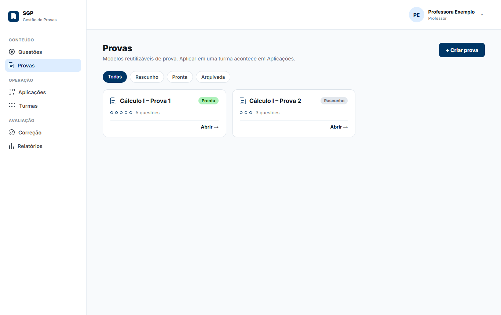

## 2. Acesso ao sistema

🚧 *A completar.* O cadastro do professor está mudando: o professor vai criar a própria conta na tela de entrada, sem convite e sem administrador (tarefas T77 e T78). Este capítulo será escrito com as telas novas.

## 3. Banco de questões

🚧 *A completar.* A padronização das tags (por exemplo, "Matemática", "matematica" e "mat" virando uma só) e as sugestões de tags ao digitar ainda vão entrar no sistema (T79). Por enquanto, em resumo: em **Questões**, use **+ Criar questão**, escreva o enunciado, as alternativas (de 2 a 5), marque a correta e, se quiser, envie uma imagem.

## 4. Turmas e alunos

🚧 *A completar.* A matrícula de alunos está mudando: entram a importação da lista de alunos por arquivo e a remoção de aluno da turma (T47, T75 e T48). Este capítulo será escrito com as telas novas.

## 5. Provas

Uma prova é um **modelo**: a lista de questões, com a pontuação de cada uma. A mesma prova pode ser aplicada várias vezes, em turmas diferentes ou na mesma turma (por exemplo, numa segunda chamada).

### Criar uma prova

1. No menu, abra **Provas** e clique em **+ Criar prova**.
2. Preencha o **Título** e, se quiser, a **Descrição**.
3. No **Banco de questões**, marque as questões da prova. Ao marcar, aparece o campo da **pontuação** daquela questão.
4. Confira o **Resumo** à direita: quantidade de questões e soma das pontuações (a soma é só informativa; o sistema não exige um total fixo).
5. Clique em **Salvar prova**.

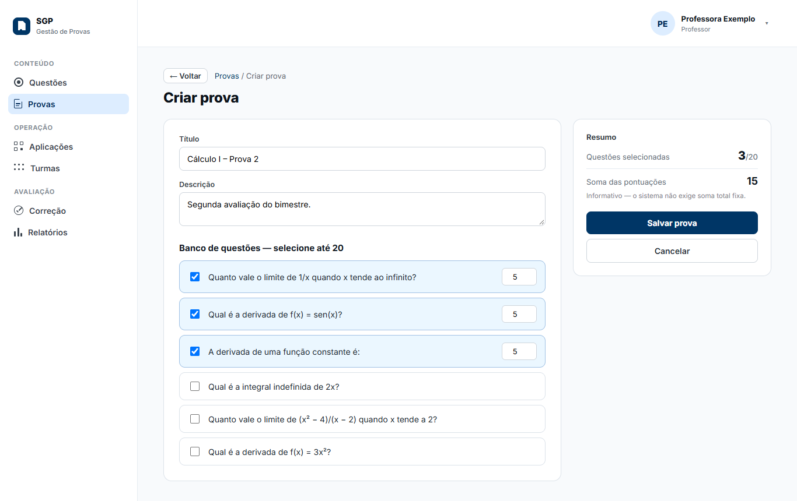

Regras da prova:

- No máximo **20 questões**. Ao chegar a 20, o título do banco mostra "(limite atingido)" e não é possível marcar outra.
- Toda questão precisa de pontuação maior que zero.

### Situação da prova

A lista de provas mostra a situação de cada uma e tem filtros no topo:

| Situação | O que significa |
|---|---|
| **Rascunho** | Ainda não foi aplicada. Pode ser editada à vontade. |
| **Pronta** | Já tem pelo menos uma aplicação. Não pode mais ser editada, para não mudar provas que já foram impressas. |
| **Arquivada** | Saiu de uso. Não aparece na hora de criar aplicações. |

A prova passa de Rascunho para Pronta sozinha, na primeira vez em que é aplicada.

### Ver e editar uma prova

Clique em **Abrir** na prova para ver as questões e a pontuação de cada uma. Dali, **Criar aplicação** leva direto para aplicá-la a uma turma.

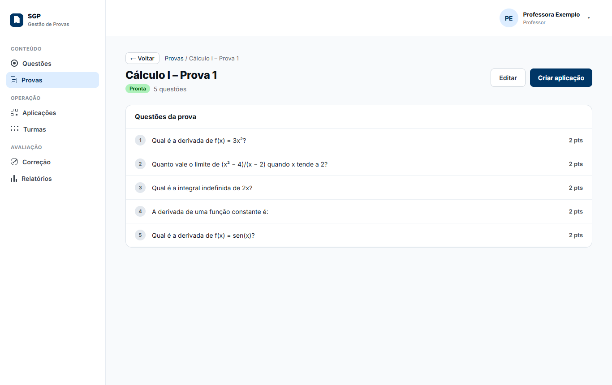

O botão **Editar** só funciona com a prova em **Rascunho**. Em uma prova **Pronta**, ele fica desabilitado; se precisar de outra versão, crie uma prova nova.

## 6. Aplicações

A aplicação junta **uma prova** e **uma turma**. É nela que as provas são geradas, impressas, corrigidas e que as notas ficam registradas.

### Criar uma aplicação

1. No menu, abra **Aplicações** e clique em **+ Criar aplicação** (ou use **Criar aplicação** na tela da prova).
2. Escolha a **Prova** e a **Turma**.
3. Informe a **Quantidade de pessoas** (quantas provas serão geradas). Se, mais adiante, as provas forem vinculadas aos alunos da turma, a quantidade passa a ser o número de alunos matriculados.
4. Clique em **Criar aplicação**.

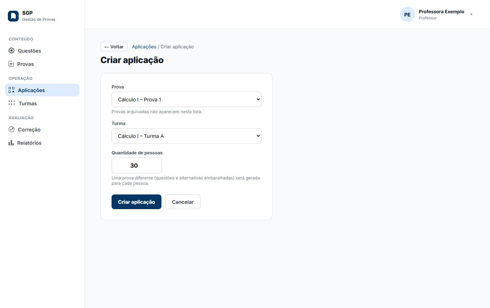

A lista de aplicações mostra a prova, a turma, a data em que foi aplicada, quantas provas foram geradas e a situação:

- **Pendente**: as provas ainda não foram baixadas para impressão;
- **Aplicada**: as provas já foram baixadas. A data aparece na lista.

Aplicar a mesma prova de novo na mesma turma cria **outra aplicação, independente**, com as próprias provas e notas. Na imagem, a "Cálculo I – Prova 1" foi aplicada à "Cálculo I – Turma A" e tem uma segunda chamada ainda pendente.

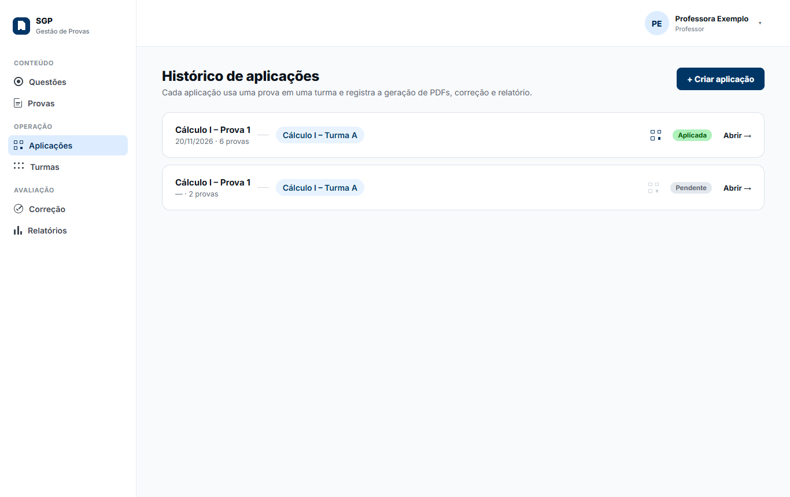

### A tela da aplicação

Ao abrir uma aplicação, os cartões do **fluxo da aplicação** levam a cada etapa, na ordem:

1. **Pré-visualização e download** — configurar, gerar e baixar as provas ([capítulo 7](#7-gerar-e-imprimir-as-provas));
2. **Versões e gabarito** — publicar o gabarito ([capítulo 8](#8-gabarito));
3. **Correções** — corrigir as provas ([capítulo 9](#9-correção));
4. **Relatório** — notas da aplicação ([capítulo 10](#10-relatórios-e-histórico)).

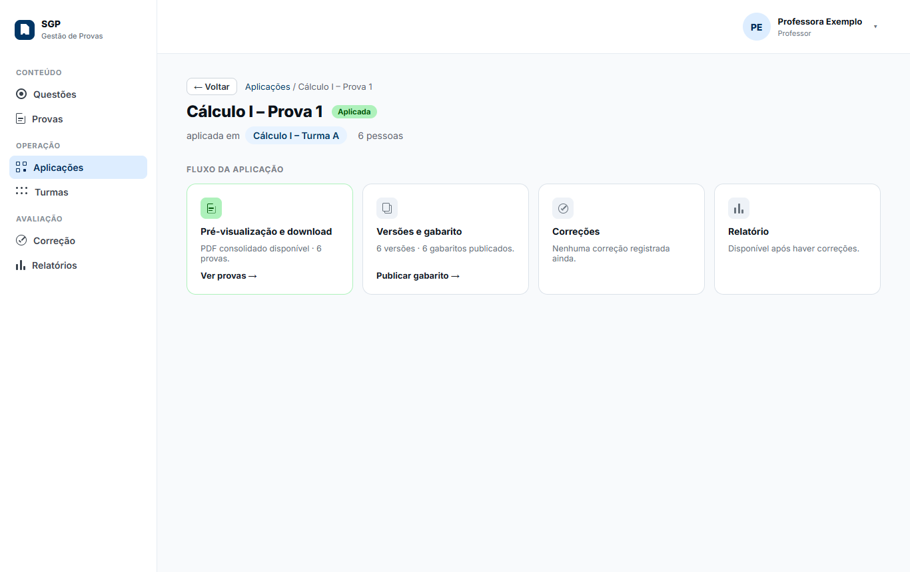

## 7. Gerar e imprimir as provas

### Configurar a geração

Na tela da aplicação, clique em **Configurar e gerar** (cartão *Pré-visualização e download*).

- **Embaralhar questões**: cada prova sai com as questões numa ordem diferente.
- **Embaralhar alternativas**: cada prova sai com as alternativas numa ordem diferente, independente das questões.
- **Vincular aos alunos matriculados na turma**: gera uma prova por aluno, já com o nome dele impresso. Desligado, a prova é anônima: o aluno escreve o nome e a matrícula à mão.

Clique em **Gerar pré-visualização**.

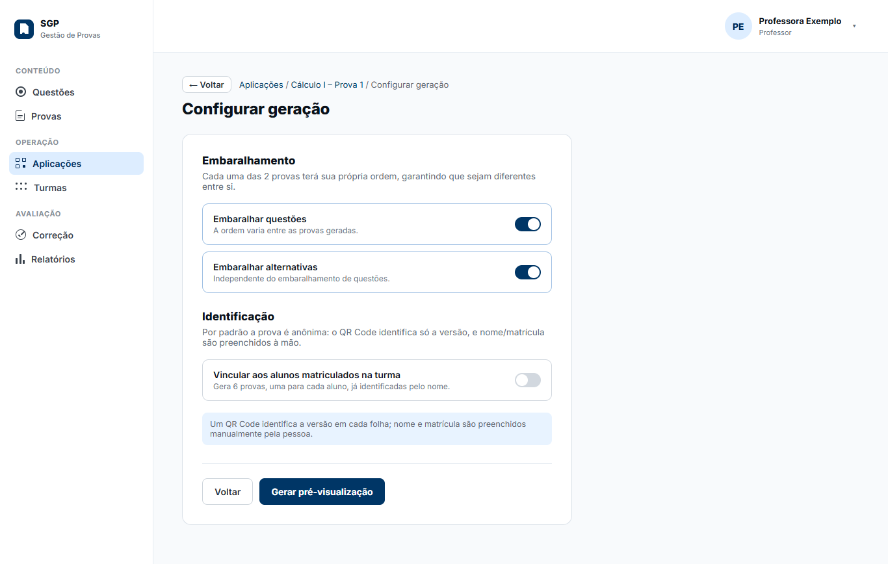

### Conferir e baixar

A pré-visualização lista as provas geradas, cada uma com o **código** que vai impresso nela (e, se vinculada, o nome do aluno). Em **Ver PDF** dá para conferir uma prova antes de imprimir todas.

Para imprimir, clique em **Baixar todas em PDF**, confira a quantidade e clique em **Confirmar e baixar**. O sistema monta **um único PDF** com todas as provas, uma depois da outra.

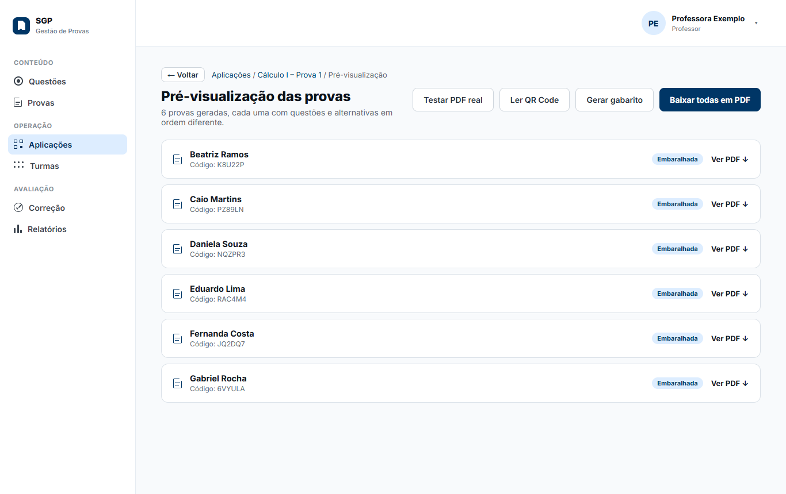

> **Importante:** ao baixar, a aplicação passa a **Aplicada** e as provas ficam com os códigos definitivos. A partir daí não dá mais para gerar as provas de novo, porque os códigos já foram impressos. O mesmo vale se já houver alguma correção lançada: gerar de novo apagaria as notas.

### O que vem impresso em cada prova

Cada prova tem:

- **Primeira página**: cabeçalho com a instituição, a prova, a turma e a data; campo da nota; nome do aluno (se vinculada) e matrícula; orientações de preenchimento; e o **quadro de resposta**, com o QR Code, o código da prova, as bolinhas de cada questão e quatro quadrados pretos nos cantos, usados na correção.
- **Páginas seguintes**: as questões, na ordem e com as alternativas daquela prova.

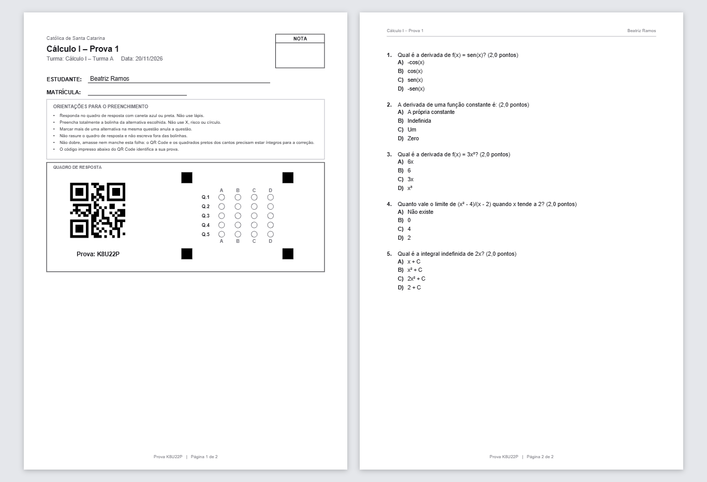

Dicas de impressão:

- Imprima em **A4, na escala 100%** (sem "ajustar à página"), para o quadro de resposta manter as medidas.
- Peça aos alunos para **preencher a bolinha inteira** com caneta azul ou preta e não rasurar o QR Code nem os quadrados dos cantos.

## 8. Gabarito

Depois da prova, o professor publica o gabarito e cada aluno consulta o da **própria** prova, pelo código impresso nela. Como cada prova pode ter uma ordem diferente, cada uma tem o seu gabarito. O aluno vê só as respostas certas, nunca a nota.

### Publicar e despublicar

Na tela da aplicação, clique em **Publicar gabarito** (cartão *Versões e gabarito*).

- **Publicar todos** libera o gabarito de todas as provas da aplicação.
- **Publicar**, em uma linha, libera só aquela prova.
- **Despublicar** (em uma linha) ou **Despublicar todos** tira o gabarito do ar. O aluno volta a ver a mensagem de gabarito não publicado até você publicar de novo.

**Exportar gabarito em PDF** gera um arquivo com o código e as respostas certas de cada prova, por exemplo para enviar aos alunos pelo Teams. Não é preciso publicar para exportar.

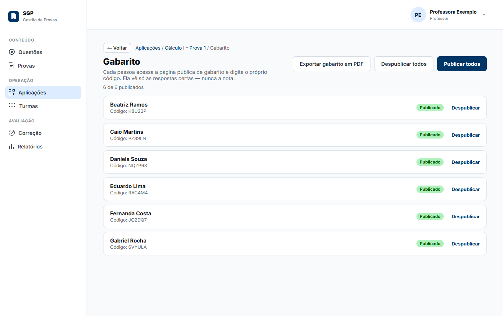

### Como o aluno consulta

O aluno acessa a página pública de gabarito, sem login, digita o código impresso na prova (abaixo do QR Code) e clica em **Consultar gabarito**:

<https://sgp-front-dc1.pages.dev/gabarito>

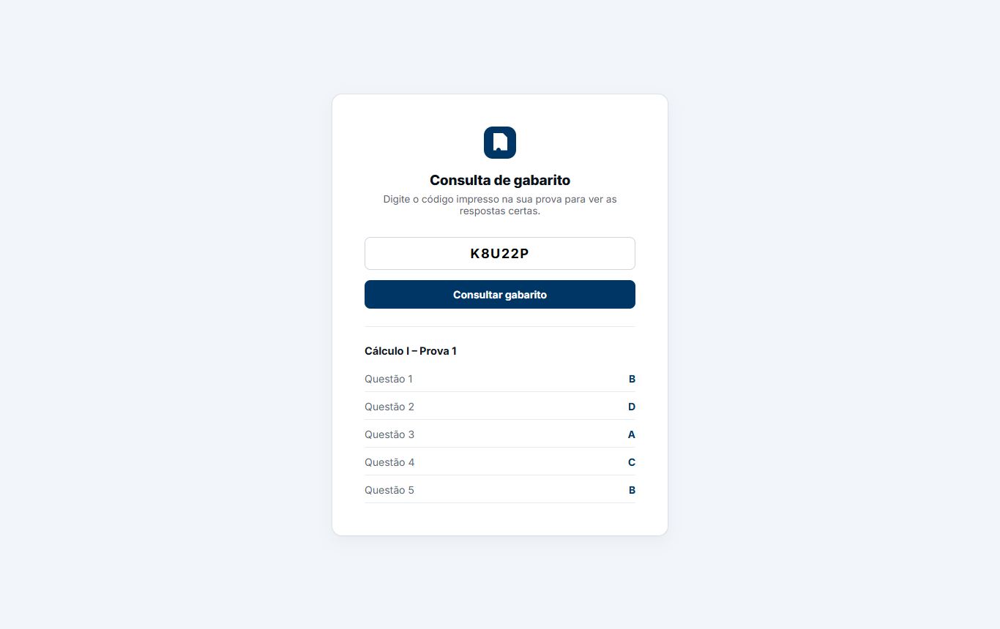

Se o gabarito ainda não foi publicado (ou foi despublicado), a página avisa: *"O gabarito desta prova ainda não foi publicado pelo professor."*

## 9. Correção

🚧 *A completar — é o capítulo principal do manual.* A tela de correção está sendo refeita (T90 e T64): o professor vai escolher a aplicação, ver a lista de alunos com a situação de cada um (corrigido, pendente) e corrigir pela **foto da folha de resposta**, com a leitura automática das bolinhas e conferência antes de gravar. Este capítulo será escrito com essas telas.

O que já vale hoje e continua valendo:

- Cada prova tem **uma correção**. Corrigir de novo substitui a anterior.
- Em provas **sem identificação**, escolha de quem é a folha ao corrigir: sem isso, a nota fica na aplicação, mas não entra no histórico do aluno.
- Também é possível **lançar a nota à mão**, sem marcar as respostas. Nesse caso a correção não entra na estatística por questão dos relatórios.

## 10. Relatórios e histórico

No menu, abra **Relatórios**.

### Notas de uma aplicação

Na aba **Por aplicação**, escolha a aplicação. O relatório mostra:

- quantas provas foram corrigidas e quantas estão pendentes;
- **média, mediana, maior e menor nota** (só das corrigidas);
- a lista de **notas** de cada aluno, com o tipo de correção (automática ou manual) e o atalho para ver ou fazer a correção.

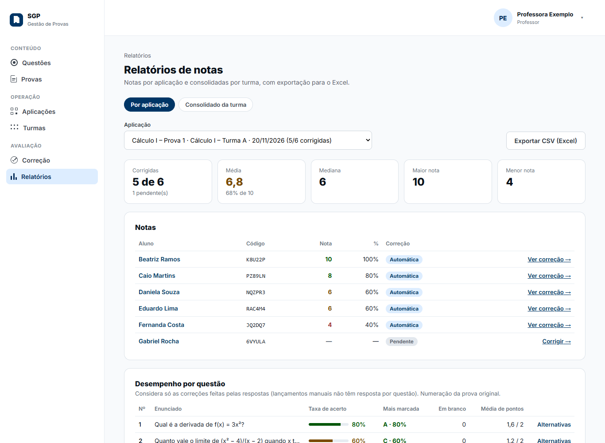

### Desempenho por questão

Mais abaixo, **Desempenho por questão** mostra, para cada questão:

- a **taxa de acerto**;
- a alternativa **mais marcada**, em verde se for a correta e em vermelho se não for (uma questão em que a maioria errou na mesma alternativa costuma indicar um ponto a revisar com a turma);
- quantos deixaram **em branco** e a **média de pontos**.

Clique em **Alternativas** para ver quantas pessoas marcaram cada alternativa. A linha "Em branco ou anulada" junta quem deixou em branco e quem marcou mais de uma bolinha. As letras são as da questão como foi cadastrada: como as provas são embaralhadas, a mesma alternativa pode ter saído com outra letra na prova de cada aluno, e o sistema já soma isso certo.

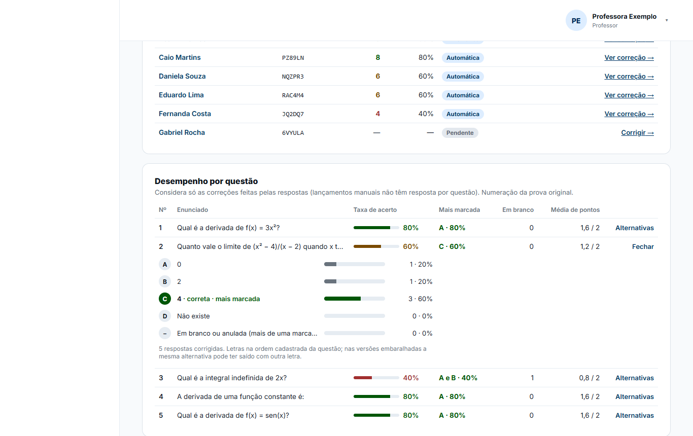

Esta parte considera só as correções feitas pelas respostas; as notas lançadas à mão não têm resposta por questão.

### Consolidado da turma

Na aba **Consolidado da turma**, escolha a turma. A tabela cruza os **alunos** com as **aplicações** da turma, com a nota de cada um, a **média do aluno** (em percentual, porque as provas podem ter notas máximas diferentes) e a **média de cada aplicação**.

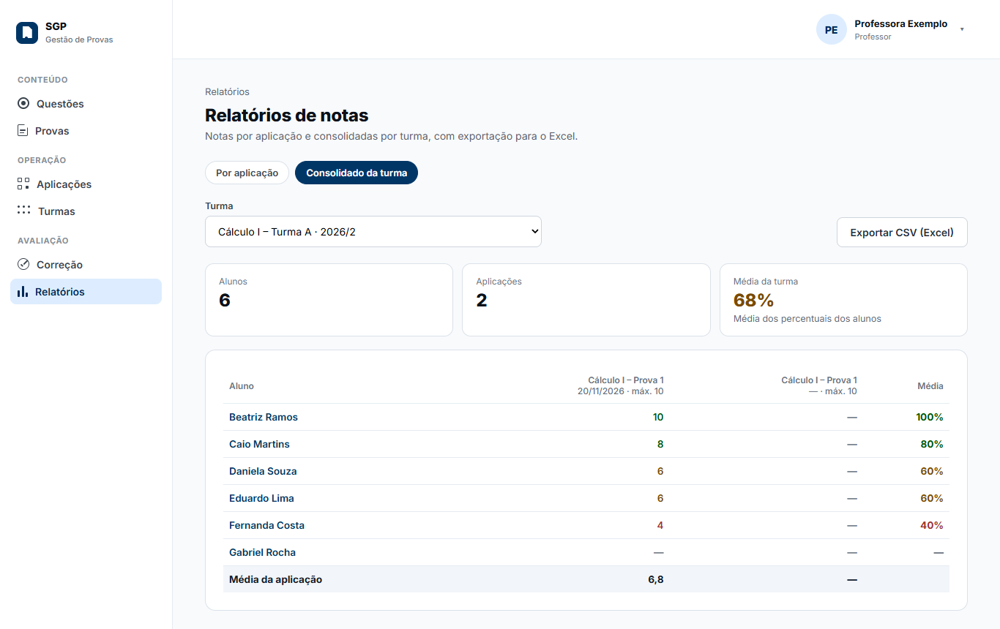

**Exportar CSV (Excel)**, nas duas abas, baixa a tabela para abrir no Excel.

### Histórico do aluno

Clique no nome de um aluno (no relatório da aplicação ou no consolidado) para abrir o histórico dele: provas corrigidas, média, melhor e pior resultado, e cada prova com a nota, a data e se o gabarito já foi publicado.

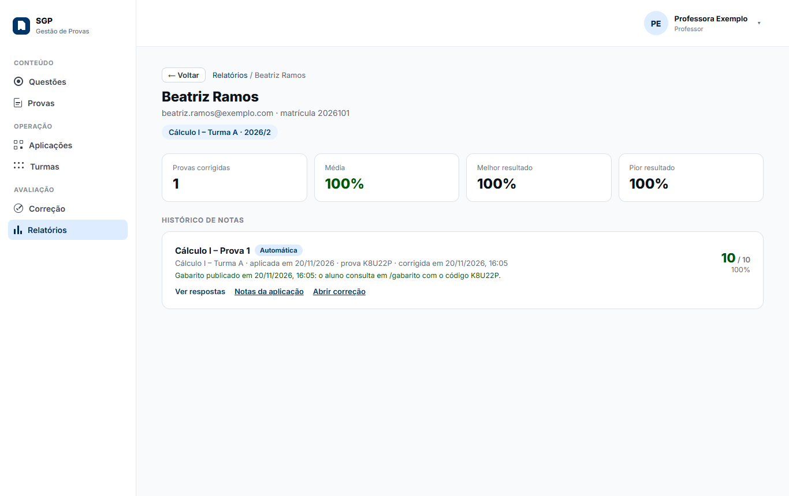

## 11. Problemas comuns

| Situação | O que fazer |
|---|---|
| O sistema demora para abrir ou para carregar a primeira tela. | O servidor gratuito "dorme" depois de um tempo sem uso. Na primeira vez ele leva alguns segundos para acordar; aguarde e tente de novo. |
| Não consigo marcar mais questões na prova. | O limite é de 20 questões por prova. |
| O botão **Editar** da prova está desabilitado. | A prova já foi aplicada (está **Pronta**). Crie uma prova nova com as mudanças. |
| Não consigo gerar as provas de novo. | A aplicação já foi baixada (**Aplicada**) ou já tem correção lançada. Os códigos impressos não podem mudar e gerar de novo apagaria as notas. Se precisar de outras provas, crie outra aplicação. |
| O PDF não é gerado e aparece um aviso sobre alternativas. | A prova tem uma questão sem alternativas (discursiva). Por enquanto, o PDF aceita só questões objetivas. |
| O aluno diz que não consegue ver o gabarito. | Confira se o gabarito daquela prova está **Publicado** e se o aluno digitou o código impresso abaixo do QR Code. |
| Uma imagem de questão não apareceu no PDF. | O PDF aceita imagens PNG e JPG. Troque a imagem da questão por um desses formatos. |
