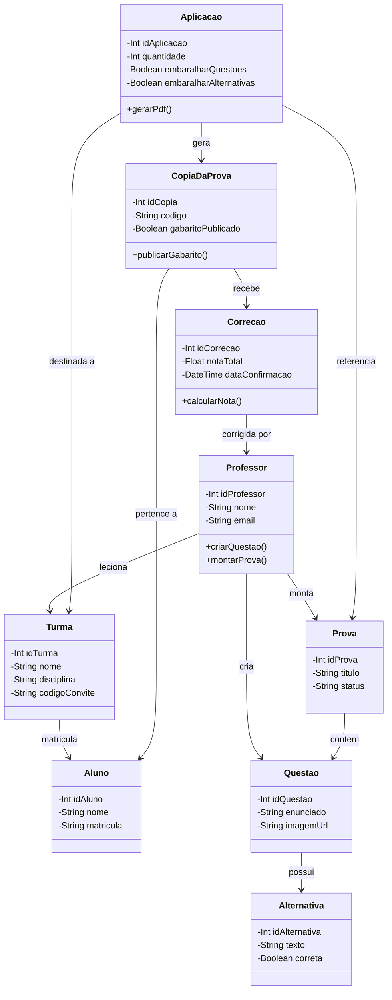

# Diagrama de Classes — SGP

Este diretório contém o diagrama de classes do **Sistema de Gestão de Provas (SGP)**, elaborado no diagrams.net (Draw.io).

## Arquivos

- [`Diagrama de classe N2 1.drawio`](./Diagrama%20de%20classe%20N2%201.drawio): arquivo-fonte editável do diagrama.
- Este Markdown documenta as classes, seus principais atributos/operações e os relacionamentos representados.

## Classes do diagrama

| Classe | Atributos | Operações |
|---|---|---|
| **Professor** | `idProfessor: Int`, `nome: String`, `email: String` | `criarQuestao()`, `montarProva()` |
| **Aluno** | `idAluno: Int`, `nome: String`, `matricula: String` | — |
| **Turma** | `idTurma: Int`, `nome: String`, `disciplina: String`, `codigoConvite: String` | — |
| **Questao** | `idQuestao: Int`, `enunciado: String`, `imagemUrl: String` | — |
| **Alternativa** | `idAlternativa: Int`, `texto: String`, `correta: Boolean` | — |
| **Prova** | `idProva: Int`, `titulo: String`, `status: String` | — |
| **Aplicacao** | `idAplicacao: Int`, `quantidade: Int`, `embaralharQuestoes: Boolean`, `embaralharAlternativas: Boolean` | `gerarPdf()` |
| **CopiaDaProva** | `idCopia: Int`, `codigo: String`, `gabaritoPublicado: Boolean` | `publicarGabarito()` |
| **Correcao** | `idCorrecao: Int`, `notaTotal: Float`, `dataConfirmacao: DateTime` | `calcularNota()` |

## Relacionamentos representados

- **Professor — Turma:** `leciona`
- **Professor — Questao:** `cria`
- **Professor — Prova:** `monta`
- **Turma — Aluno:** `matricula`
- **Prova — Questao:** `contem`
- **Questao — Alternativa:** `possui`
- **Aplicacao — Prova:** `referencia`
- **Aplicacao — Turma:** `destinada a`
- **Aplicacao — CopiaDaProva:** `gera`
- **CopiaDaProva — Aluno:** `pertence a`
- **CopiaDaProva — Correcao:** `recebe`
- **Correcao — Professor:** `corrigida por`

## Visualização em Mermaid

A representação abaixo oferece uma visualização textual dos principais relacionamentos no GitHub. Para consultar o layout original e editar o desenho, abra o arquivo `.drawio` no [diagrams.net](https://app.diagrams.net/).

## Como abrir e editar

1. Acesse [diagrams.net](https://app.diagrams.net/).
2. Escolha **Device** (Dispositivo) e abra o arquivo `.drawio`.
3. Faça as alterações necessárias e salve uma cópia atualizada.

> **Observação:** a visualização Mermaid é uma representação complementar para leitura rápida. O arquivo `.drawio` é a fonte do diagrama original.
