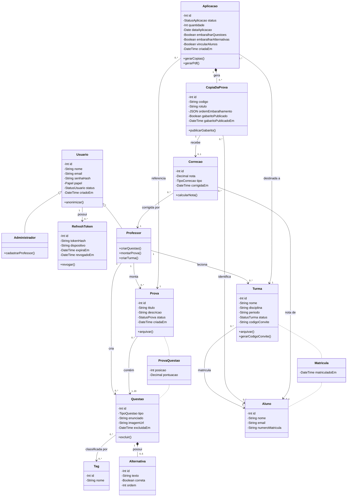

# Diagrama de Classes — SGP

Classes de domínio do **Sistema de Geração de Provas (SGP)**, alinhadas ao modelo de dados (MER/DER em [`../modelo-dados/`](../modelo-dados/)). Cada classe corresponde a uma tabela do DER; os atributos usam os mesmos nomes das colunas, em camelCase (`numero_matricula` → `numeroMatricula`).

## Arquivos

- [`Diagrama de classe N2 1.drawio`](./Diagrama%20de%20classe%20N2%201.drawio): arquivo-fonte editável (diagrams.net / draw.io).
- [`diagrama-classes.png`](./diagrama-classes.png): imagem usada no README principal (Seção 3).
- Este Markdown documenta as classes, os relacionamentos e as decisões de modelagem.

## Classes

| Classe | Atributos | Operações | Tabela no DER |
|---|---|---|---|
| **Usuario** | `id: Int`, `nome: String`, `email: String`, `senhaHash: String`, `papel: Papel`, `status: StatusUsuario`, `criadoEm: DateTime` | `anonimizar()` | `usuario` (coluna `papel`) |
| **Administrador** | — (herda de Usuario) | `cadastrarProfessor()` | `usuario` (papel = ADMINISTRADOR) |
| **RefreshToken** | `id: Int`, `tokenHash: String`, `dispositivo: String`, `expiraEm: DateTime`, `revogadoEm: DateTime` | `revogar()` | `refresh_token` |
| **Professor** | — (herda de Usuario) | `criarQuestao()`, `montarProva()`, `criarTurma()` | `usuario` (papel = PROFESSOR) |
| **Turma** | `id: Int`, `nome: String`, `disciplina: String`, `periodo: String`, `status: StatusTurma`, `codigoConvite: String` | `arquivar()`, `gerarCodigoConvite()` | `turma` |
| **Prova** | `id: Int`, `titulo: String`, `descricao: String`, `status: StatusProva`, `criadaEm: DateTime` | `arquivar()` | `prova` |
| **Questao** | `id: Int`, `tipo: TipoQuestao`, `enunciado: String`, `imagemUrl: String`, `excluidaEm: DateTime` | `excluir()` | `questao` |
| **ProvaQuestao** | `posicao: Int`, `pontuacao: Decimal` | — | `prova_questao` |
| **Tag** | `id: Int`, `nome: String` | — | `tag` / `questao_tag` |
| **Alternativa** | `id: Int`, `texto: String`, `correta: Boolean`, `ordem: Int` | — | `alternativa` |
| **Aplicacao** | `id: Int`, `status: StatusAplicacao`, `quantidade: Int`, `dataAplicacao: Date`, `embaralharQuestoes: Boolean`, `embaralharAlternativas: Boolean`, `vincularAlunos: Boolean`, `criadaEm: DateTime` | `gerarCopias()`, `gerarPdf()` | `aplicacao` |
| **Aluno** | `id: Int`, `nome: String`, `email: String`, `numeroMatricula: String` | — | `aluno` |
| **Matricula** | `matriculadoEm: DateTime` | — | `matricula` |
| **CopiaDaProva** | `id: Int`, `codigo: String`, `rotulo: String`, `ordemEmbaralhamento: JSON`, `gabaritoPublicado: Boolean`, `gabaritoPublicadoEm: DateTime` | `publicarGabarito()` | `copia_prova` |
| **Correcao** | `id: Int`, `nota: Decimal`, `tipo: TipoCorrecao`, `corrigidaEm: DateTime` | `calcularNota()` | `correcao` |

Classes em amarelo no diagrama são **classes de associação**: guardam dados da própria relação (a pontuação da questão naquela prova, a data da matrícula).

### Enumerações

| Enumeração | Valores |
|---|---|
| `Papel` | ADMINISTRADOR, PROFESSOR |
| `StatusUsuario` | CONVIDADO, ATIVO, ANONIMIZADO |
| `StatusTurma` | ATIVA, ARQUIVADA |
| `TipoQuestao` | OBJETIVA, DISCURSIVA |
| `StatusProva` | RASCUNHO, PRONTA, ARQUIVADA |
| `StatusAplicacao` | PENDENTE, APLICADA |
| `TipoCorrecao` | AUTOMATICA, MANUAL |

## Relacionamentos

| Relacionamento | Tipo | Multiplicidade |
|---|---|---|
| Professor → Usuario | Generalização | — |
| Administrador → Usuario | Generalização | — |
| Usuario → RefreshToken (*possui*) | Associação | 1 → 0..* |
| Professor → Turma (*leciona*) | Associação | 1 → 0..* |
| Professor → Prova (*monta*) | Associação | 1 → 0..* |
| Professor → Questao (*cria*) | Associação | 1 → 0..* |
| Prova → Questao (*contém*) | Associação, com a classe de associação ProvaQuestao | 0..* → 1..20 |
| Questao → Tag (*classificada por*) | Associação | 0..* → 0..* |
| Questao → Alternativa (*possui*) | Composição | 1 → 0..5 |
| Aplicacao → Prova (*referencia*) | Associação | 0..* → 1 |
| Aplicacao → Turma (*destinada a*) | Associação | 0..* → 1 |
| Turma → Aluno (*matricula*) | Associação, com a classe de associação Matricula | 0..* → 0..* |
| Aplicacao → CopiaDaProva (*gera*) | Composição | 1 → 0..* |
| CopiaDaProva → Aluno (*identifica*) | Associação | 0..* → 0..1 |
| CopiaDaProva → Correcao (*recebe*) | Associação | 1 → 0..1 |
| Correcao → Aluno (*nota de*) | Associação | 0..* → 0..1 |
| Correcao → Professor (*corrigida por*) | Associação | 0..* → 1 |

## Decisões de modelagem

- **Usuario, Professor e Administrador:** o DER tem uma única tabela `usuario`, diferenciada pela coluna `papel`. No diagrama isso vira uma generalização: Professor e Administrador herdam os dados de Usuario, e só o Professor tem turmas, questões e provas.
- **O aluno não é usuário:** Aluno é só um registro (nome, e-mail e matrícula) informado pelo professor; não tem senha nem login, por isso não herda de Usuario.
- **Composição:** Alternativa só existe dentro da sua Questao (no máximo 5; nenhuma nas discursivas) e CopiaDaProva só existe dentro da sua Aplicacao. Apagar o todo apaga as partes (`ON DELETE CASCADE` no DER).
- **Prova contém de 1 a 20 questões**, com posição e pontuação próprias em cada prova (classe de associação ProvaQuestao); a mesma questão pode estar em várias provas.
- **Uma correção por cópia** (0..1). A nota pertence a um aluno: o da cópia nominal ou, nas provas sem identificação, o aluno escolhido pelo professor no lançamento manual.
- **Status como enumerações**, com os mesmos valores dos `ENUM` do banco.

## Visualização em Mermaid

Representação textual dos relacionamentos, renderizada pelo GitHub. O layout oficial é o do arquivo `.drawio`.

## Como abrir e editar

1. Acesse [diagrams.net](https://app.diagrams.net/).
2. Escolha **Device** (Dispositivo) e abra o arquivo `.drawio`.
3. Depois de alterar, exporte de novo como PNG com o nome `diagrama-classes.png` (Arquivo → Exportar como → PNG).
